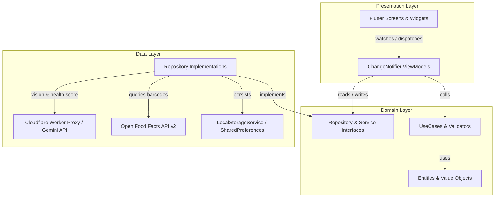

# NutriLens AI 🥑

[](https://flutter.dev)
[](https://dart.dev)
[-2ECC71)](https://flutter.dev)
[](test/)
[](LICENSE)
[](https://tobishakur.github.io/nutrilens-ai-tracker/)

**Live Demo:** [https://tobishakur.github.io/nutrilens-ai-tracker/](https://tobishakur.github.io/nutrilens-ai-tracker/)

Most calorie trackers fail on home-cooked and prepared meals: either you spend five minutes typing and weighing every item by hand, or you settle for generic database averages that ignore the actual brands and ingredients in your kitchen.

**NutriLens AI** solves this by putting your pantry (*Mi Alacena*) first. You scan the packaged ingredients you keep at home once, and when you snap a photo of a prepared plate, Gemini Vision identifies the dish and resolves its macros against your real pantry inventory.

---

## Key Differentiators

### 1. Pantry-First Ingredient Scanning
Build your pantry once using any of three input methods in [BarcodeScannerSheet](lib/features/alacena/presentation/widgets/barcode_scanner_sheet.dart):
- **Barcode lookup:** Queries **Open Food Facts API v2** first (`world.openfoodfacts.org/api/v2/product/{code}.json`), with a conditional fallback to **Gemini** when a product is not found in the catalog.
- **Product photo:** Snap or upload the front of a package so Gemini Vision identifies the product name, brand, category, and serving macros.
- **Nutrition facts label photo:** Snap or upload the nutrition table on the package so Gemini Vision extracts the serving size (g/ml) and macros (falling back to 100g when only per-100g values are printed).

During scanning, extracted data pre-fills the ingredient form ([AgregarIngredienteSheet](lib/features/alacena/presentation/widgets/agregar_ingrediente_sheet.dart)) so you can review or adjust the name, brand, serving size, category, and macros before saving.

When you later log a **prepared or home-cooked meal**, [MatchPantryIngredientsUseCase](lib/features/scanner/domain/usecases/match_pantry_ingredients_usecase.dart) cross-references AI-detected ingredients against your saved pantry:
- Single matches automatically pull your saved brand and macro profile.
- Multi-brand matches (for example, two different yogurts or breads in your pantry) trigger [ConflictoMarcaDialog](lib/features/scanner/presentation/widgets/conflicto_marca_dialog.dart) so you choose which one you used.

### 2. AI Health Score (Macros + Micronutrients)
Every logged meal gets a **0–100 Health Score** ([HealthScoreDetailSheet](lib/features/diario/presentation/widgets/health_score_detail_sheet.dart)) with a written rationale evaluating both **macronutrient balance** and **micronutrient density / whole-food quality**:
- **On-demand `?/100` for manual meals:** Meals built manually start with an interactive `?/100` badge ([HealthScoreBadge](lib/features/diario/presentation/widgets/health_score_badge.dart)) instead of forcing an upfront AI call—tap it whenever you want Gemini to score the meal.
- **Stale-edit detection:** If you add, remove, or resize ingredients in grams after scoring, the badge flags the score as outdated so you can recalculate on demand.

### 3. Built for Testing Anytime (Web Demo + Sample Meal + ES/EN)
- **Built-in Sample Meal on Web:** In [ScannerScreen](lib/features/scanner/presentation/views/scanner_screen.dart), tapping the top-bar **Sample / Prueba** pill opens a preview card backed by a bundled real meal photo ([sample_meal.jpg](assets/images/sample_meal.jpg)), letting anyone test the full Gemini Vision + pantry matching flow on Web without taking or uploading a photo.
- **Flexible capture dock:** Along with the camera shutter, the scanner provides **Library** (pick from gallery/files) and **Manual** (build a meal directly from pantry or custom items).
- **Bilingual Español / English:** Switch languages at runtime from **Profile → Language** ([PerfilScreen](lib/features/perfil/presentation/views/perfil_screen.dart)). Both the Flutter UI (`lib/l10n/`) and Gemini AI responses (dish detection, label parsing, and Health Score explanations) adapt immediately to the selected locale.

---

## Additional Core Features

- **Multi-Layer Caloric Gauge (`CustomPainter`):** Circular daily target ring ([CalorieRingWidget](lib/features/diario/presentation/widgets/calorie_ring_widget.dart)) showing base progress, Level 1 surplus, Level 2 critical surplus, and clean zero state.
- **Asymmetric Tolerance Bands & Weekly Analytics:** Independent lower (`-`) and upper (`+`) caloric tolerance targets, Monday–Sunday historical navigation, compliance streaks, pantry usage %, and weekly top macro contributors in **Profile**.
- **Offline-First Local Persistence:** All pantry items, daily meal logs, nutritional targets, and locale preferences persist locally via [LocalStorageService](lib/core/storage/local_storage_service.dart) (`shared_preferences`).

---

## Security & Cloudflare Worker Proxy (`worker/`)

A static Flutter Web SPA (such as the GitHub Pages deployment) **must never** be compiled with `--dart-define=GEMINI_API_KEY=...`, because compile-time `String.fromEnvironment` values are embedded directly into the compiled JavaScript bundle and can be extracted by anyone inspecting the network or assets.

To keep the live web demo functional without exposing credentials, all production web AI requests are routed through a lightweight **Cloudflare Worker** in [`worker/`](worker/src/index.ts) via `GEMINI_PROXY_URL`:

- **Server-side secret:** `GEMINI_API_KEY` is stored as an encrypted Cloudflare Worker secret (`wrangler secret put GEMINI_API_KEY`) and attached upstream as `x-goog-api-key`.
- **Origin validation (CORS):** Only accepts browser requests from `https://tobishakur.github.io` (and `http://localhost` / `http://127.0.0.1` for local development); unknown origins receive `403 Forbidden`.
- **Strict endpoint allowlist:** Only accepts `POST` requests to `/v1beta/models/gemini-2.5-flash:generateContent` and `/v1beta/models/gemini-flash-latest:generateContent`.
- **Payload & rate limits:** Rejects payloads over **16 MB** (`413 Payload too large`) and enforces a per-IP sliding-window rate limit of **30 requests/minute** (`429 Too many requests`).

### Running Locally

**Prerequisites:** Flutter SDK (`>=3.19.0`), Dart SDK (`>=3.3.0`), and optionally Node.js + Wrangler if running or deploying the Cloudflare Worker.

```bash
git clone https://github.com/TobiShakur/nutrilens-ai-tracker.git
cd nutrilens-ai-tracker
flutter pub get
```

Run the app pointing to a Cloudflare Worker proxy (recommended) or with a local development API key:

```bash
# Recommended: route AI calls through your Worker (local or deployed)
flutter run -d chrome --dart-define=GEMINI_PROXY_URL=https://your-worker.workers.dev

# Local dev only (never use GEMINI_API_KEY in public web builds)
flutter run -d chrome --dart-define=GEMINI_API_KEY=your_local_gemini_api_key
```

Build Web for production (same flag used by [deploy_pages.yml](.github/workflows/deploy_pages.yml)):

```bash
flutter build web --release --base-href "/nutrilens-ai-tracker/" --dart-define=GEMINI_PROXY_URL=https://your-worker.workers.dev
```

### Running & Deploying the Cloudflare Worker

```bash
cd worker
npm install
npm run typecheck

# Local Worker dev (create worker/.dev.vars from worker/.dev.vars.example with your GEMINI_API_KEY)
npm run dev

# Production deploy to Cloudflare
npx wrangler secret put GEMINI_API_KEY
npm run deploy
```

---

## Architecture & Stack

- **Stack:** `Dart & Flutter` · `Clean Architecture` · `MVVM + Provider` · `Gemini API (LLM)` · `Open Food Facts API v2` · `Cloudflare Workers` · `153 Unit & Widget Tests`



### Project Structure

```text
├── assets/
│   └── images/
│       └── sample_meal.jpg       # Bundled real dish photo for Web demo testing
├── lib/
│   ├── core/
│   │   ├── constants/            # ApiConstants (GEMINI_PROXY_URL / GEMINI_API_KEY resolution)
│   │   ├── failures/             # Typed ScannerFailure hierarchy
│   │   ├── localization/         # LocaleProvider & BuildContext l10n extensions
│   │   ├── network/              # LogSanitizer (redacts sensitive headers/keys)
│   │   ├── storage/              # LocalStorageService (shared_preferences wrapper)
│   │   └── theme/                # AppColors, AppTextStyles, AppTheme
│   ├── features/
│   │   ├── alacena/              # Pantry inventory, barcode lookup & label vision
│   │   ├── diario/               # Daily dashboard, calorie ring & on-demand Health Score
│   │   ├── perfil/               # Goals, tolerance bands, weekly stats & ES/EN dialog
│   │   ├── scanner/              # Camera/library/sample capture, pantry matching & review
│   │   └── shell/                # Bottom navigation shell (MainShellScreen)
│   ├── l10n/                     # ARB localization files (app_en.arb, app_es.arb)
│   ├── widgets/                  # DesktopWrapper showcase frame & shared dialogs
│   └── main.dart                 # MultiProvider dependency wiring & app bootstrap
├── test/                         # 153 unit, ViewModel, repository & widget tests
└── worker/
    ├── src/index.ts              # Cloudflare Worker Gemini proxy (CORS, allowlist, rate limit)
    └── wrangler.toml             # Worker configuration
```

---

## Testing & Code Quality

```bash
# Verify formatting
dart format --output=none --set-exit-if-changed .

# Run static analysis
flutter analyze

# Execute all 153 unit, ViewModel, and widget tests
flutter test
```

Static analysis enforces `package:flutter_lints/flutter.yaml` along with `avoid_print`, `prefer_const_constructors`, `prefer_const_literals_to_create_immutables`, `prefer_const_declarations`, `cancel_subscriptions`, and `close_sinks` ([analysis_options.yaml](analysis_options.yaml)).

---

## Author & Contact

**Tobías Gutiérrez Reboredo**  
Mobile & Full-Stack Software Engineer

- **GitHub:** [github.com/TobiShakur](https://github.com/TobiShakur)
- **LinkedIn:** [linkedin.com/in/tobias-gutierrez-reboredo-991084279](https://www.linkedin.com/in/tobias-gutierrez-reboredo-991084279/)
- **Upwork:** [Tobías Gutiérrez on Upwork](https://www.upwork.com/freelancers/~01888a10d384c2957d?viewMode=1)
- **Email:** [tobigutierrez26@gmail.com](mailto:tobigutierrez26@gmail.com)

---

## License

This project is open-source under the [MIT License](LICENSE).
