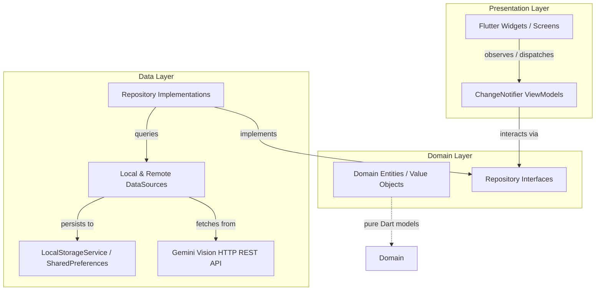

# NutriLens 🥑🥗

[](https://flutter.dev)
[](https://dart.dev)
[-2ECC71)](https://flutter.dev)
[](https://github.com)
[](LICENSE)
[](https://tobishakur.github.io/nutrilens-ai-tracker/)

> **NutriLens** is a production-grade, offline-first mobile and web application engineered with **Clean Architecture + MVVM (Provider)**. It integrates **Google Gemini Multimodal Vision AI** to recognize food dishes from photos, automatically match detected ingredients against the user's pantry inventory (*Mi Alacena*), and render an interactive multi-layer caloric gauge with real-time macro tracking.

🔗 **Live Production Demo:** [https://tobishakur.github.io/nutrilens-ai-tracker/](https://tobishakur.github.io/nutrilens-ai-tracker/)

---

## ✨ Key Capabilities

1. **Multimodal Food AI Recognition (Gemini 2.5 Flash)**
   - Captures photos via camera or gallery.
   - Client-side image downsampling (`1024x1024 @ 80% JPEG`) for bandwidth efficiency and fast inference.
   - Structured JSON schema response parsing with defensive fallbacks and nutrition scoring.

2. **Automated Pantry Inventory Matching (*Mi Alacena*)**
   - Automatically cross-references detected food items with items stored in the user's pantry.
   - Highlights pantry matches with visual tags, auto-selects brand varieties, and resolves multi-brand conflicts.

3. **Multi-Layer Caloric & Macro Gauge (`CustomPainter`)**
   - Canvas-rendered, zero-dependency circular gauge supporting:
     - **Base Target**: Smooth green arc with a physical glow knob.
     - **Level 1 Surplus**: Amber warning arc tracking caloric overrun.
     - **Level 2 Surplus**: Crimson alert arc for severe surplus.
     - **True Zero**: Clean inactive track when calories are 0 kcal (no false-positive knobs).

4. **Dynamic Health Score & Nutritional Profiling**
   - Calculates a daily score (0–100) based on macro equilibrium, caloric boundary proximity, and ingredient whole-food balance.
   - Independent lower and upper tolerance boundaries configured per user profile.
   - Weekly historical navigation (Monday through Sunday) with persistent averages.

5. **Offline-First Local Persistence**
   - Robust JSON serialization across all domain entities.
   - Unified `LocalStorageService` backed by `shared_preferences` with cache-first memory fallbacks.

---

## 🏛 Clean Architecture & Reactive State Flow

The codebase strictly enforces the separation of concerns across three core layers:



---

## 📂 Project Structure

```text
lib/
├── core/
│   ├── config/             # Environment variables (Gemini API Key via dart-define)
│   ├── storage/            # LocalStorageService (shared_preferences wrapper)
│   ├── theme/              # AppColors (Fitia-inspired palette), AppTheme, Typography
│   └── utils/              # Value objects (Result<T>, ImagenPlato)
├── features/
│   ├── alacena/            # Pantry management (inventory, categories, custom portions)
│   │   ├── data/           # AlacenaLocalDataSource, local cache & persistence
│   │   ├── domain/         # IngredienteAlacena, CategoriaAlacena, contracts
│   │   └── presentation/   # AlacenaViewModel, AlacenaScreen, bottom sheets
│   ├── diario/             # Daily food log & calorie dashboard
│   │   ├── data/           # DiarioRepositoryImpl, seed data
│   │   ├── domain/         # DiarioDia, ComidaItem, ComidaIngrediente
│   │   └── presentation/   # DiarioViewModel, DashboardScreen, CalorieRingWidget
│   ├── perfil/             # Nutritional configuration & weekly statistics
│   │   ├── data/           # PerfilDataSource, target settings persistence
│   │   ├── domain/         # ConfiguracionNutricional, tolerances
│   │   └── presentation/   # PerfilViewModel, PerfilScreen, weekly bar chart
│   └── scanner/            # Camera capture & Gemini multimodal AI analysis
│       ├── data/           # Gemini Vision API client, image compressor
│       ├── domain/         # PlatoDetectadoModel, ScannerRepository contract
│       └── presentation/   # ScannerViewModel, ScannerScreen, recipe review modal
└── main.dart               # MultiProvider bootstrap, service initialization
```

---

## 🔒 Security & Environment Architecture

To protect sensitive API credentials from repository leaks:
- **Zero Hardcoded Secrets**: No API keys are present in `lib/` or committed files.
- **Dart Define Injection**: Credential resolution uses compile-time environment flags:
  ```bash
  --dart-define=GEMINI_API_KEY=YOUR_ACTUAL_API_KEY
  ```
- **Fallback Template**: `.env.example` provides the structure for local environment setup.

---

## 🚀 Getting Started

### Prerequisites
- [Flutter SDK](https://docs.flutter.dev/get-started/install) (version `>=3.19.0`)
- [Dart SDK](https://dart.dev/get-dart) (version `>=3.3.0`)
- A Google Gemini API Key (available free from [Google AI Studio](https://aistudio.google.com/))

### Installation
```bash
# Clone the repository
git clone https://github.com/TobiShakur/nutrilens-ai-tracker.git
cd nutrilens-ai-tracker

# Install dependencies
flutter pub get
```

### Running Locally

```bash
# Run on Chrome Web with your Gemini API Key
flutter run -d chrome --dart-define=GEMINI_API_KEY=your_gemini_api_key

# Run on Android / iOS device
flutter run --dart-define=GEMINI_API_KEY=your_gemini_api_key
```

### Building for Production Web

```bash
flutter build web --release --dart-define=GEMINI_API_KEY=your_gemini_api_key
```

---

## 🧪 Testing & Code Quality

NutriLens maintains 100% pass rates across all unit and state tests:

```bash
# Run strict static analysis
flutter analyze

# Execute all 45 unit and ViewModel tests
flutter test
```

### Analysis Quality Standards
- `strict-casts: true`
- `strict-inference: true`
- `strict-raw-types: true`
- Mandatory `const` constructors where applicable.

---

## 👨‍💻 Author & Contact

**Tobías Gutiérrez Reboredo**  
Mobile & Full-Stack Software Engineer — Computer Science & Engineering (FIUBA)

- **LinkedIn:** [linkedin.com/in/tobias-gutierrez-reboredo-991084279](https://www.linkedin.com/in/tobias-gutierrez-reboredo-991084279/)
- **Upwork:** [Tobías Gutiérrez on Upwork](https://www.upwork.com/freelancers/~01888a10d384c2957d?viewMode=1)
- **Email:** [tobigutierrez26@gmail.com](mailto:tobigutierrez26@gmail.com)

---

## 📄 License
This project is open-source under the [MIT License](LICENSE).
